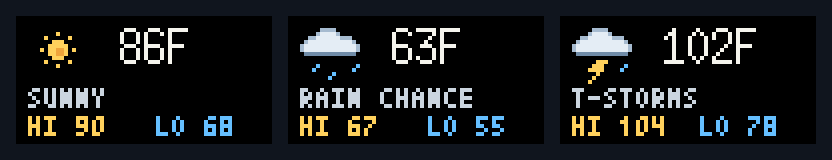

# Tidbytr

Tidbytr runs a custom app on a **Tidbyt Gen 2 with stock firmware**, alongside Store apps. A local TypeScript server and Home Assistant add-on render clock, U.S. National Weather Service forecasts/alerts, and favorite-team sports scores, then push the selected screen through the Tidbyt API.

By default, a 30-second clock separates 15-second weather, baby-age, and star-flight screens. Critical warnings/watches can interrupt. Quiet hours, snooze, and manual controls remain available. Priority scheduling is an alternative mode for event-driven weather/sports and background coexistence with Store apps. These rules govern Tidbytr's selections; device/cloud latency and other installed apps can affect physical display time.

## Install and configure

You need a Gen 2 configured in the Tidbyt mobile app, its device ID/API key, Internet access from the device and add-on, and Home Assistant with the add-on store on amd64 or aarch64/arm64. Home Assistant Container/Core do not include the add-on store. Custom firmware and an inbound LAN display port are no longer required. Node.js and Pixlet are bundled.

1. Open **Settings → Add-ons → Add-on Store → ⋮ → Repositories** (some versions call these Apps/App Store).
2. Add `https://github.com/dteske25/tidbytr`, refresh the store, and install **Tidbytr**. The first source build may take several minutes.
3. In Configuration, enter the API key and device ID from your device's settings in the Tidbyt mobile app, plus your location and NWS contact:

   ```yaml
   tidbyt_api_token: "YOUR_DEVICE_API_KEY"
   tidbyt_device_id: "YOUR_DEVICE_ID"
   installation_id: tidbytrmain
   timezone: America/Chicago
   latitude: 39.0997
   longitude: -94.5786
   nws_contact: "Tidbytr (you@example.com)"
   favorite_teams:
     - KC
   baby_birth_date: ""
   baby_name: ""
   starfield_enabled: true
   schedule_mode: clock-cycle
   clock_seconds: 30
   screen_seconds: 15
   log_level: info
   scheduler_interval_seconds: 60
   refresh_interval_seconds: 600
   quiet_hours_start: ""
   quiet_hours_end: ""
   ```

   Replace the credentials, location, timezone, and contact. Favorite teams accept abbreviations or full names from the NFL, NBA, MLB, and NHL; use `[]` to disable sports. Set both quiet-hour fields (for example `22:00` and `06:00`) to enable quiet hours.
4. Save and start the add-on. Use **Open Web UI** through Home Assistant Ingress. Enable Start on boot if desired.
5. Check cloud delivery reports **Accepted**, then check the physical device. Keep `installation_id` unchanged to update the same app. Other apps stay managed in the Tidbyt mobile app.

API acceptance confirms a server response, not physical display. Outbound HTTPS is required to `api.tidbyt.com`, `api.weather.gov`, and `site.api.espn.com` (when sports are enabled).

## Upgrade from 0.5 / HDK

1. Back up the existing add-on and note its settings. If you flashed HDK, restore production firmware using [HDK's Back to Normal instructions](https://github.com/tidbyt/hdk#back-to-normal) for Gen 2. If already on stock firmware, no firmware change is needed. This server does not flash the device.
2. Refresh/check for updates in the HA Add-on Store and update Tidbytr to **0.8.3**. HA builds from the versioned `tidbytr/source.tar.gz` bundle.
3. Enter `tidbyt_api_token` and `tidbyt_device_id`, keeping your location, timezone, teams, and quiet hours.
4. Remove the obsolete `display_base_url` option and any retained port 8788 mapping. Save and restart. The old `/current.webp` firmware feed is no longer served.
5. Open the dashboard, check API acceptance, then try Show now and observe the actual device and animated weather app.

Saved screen priorities, provider caches, and ordinary settings are retained. Nonempty credentials/device IDs from HA options or environment take precedence at startup so old dashboard saves cannot hide new credentials or key rotation. Existing local frames/pull records do not count as cloud delivery. See [configuration ownership](tidbytr/DOCS.md#configuration-ownership).

## Dashboard and troubleshooting

The dashboard separates the last API-accepted screen from the selected preview and next candidate. Show now requests immediate display and a one-minute Tidbytr selection hold; critical alerts can take precedence. Skip and Snooze immediately select replacement Tidbytr content. These actions do not suspend the device's other apps.

| Symptom | Check |
| --- | --- |
| Delivery is unconfigured | Set both credentials in add-on Configuration and restart. |
| HTTP 401/403 | Check the API key belongs to the configured device. |
| HTTP 404 | Check the device ID. |
| HTTP 429 | Increase minimum screen time to reduce API updates. |
| Accepted, but no visible update | Check stock firmware, device Internet access, and app rotation; try Show now. |
| Weather/sports is degraded | Check Internet access, NWS contact/location, and teams. NWS coverage is for the United States. |
| Add-on fails to start | Check its Log tab for the build/startup error. |

Internet/cloud outages prevent new images reaching the device; previously uploaded content may remain in rotation. Server freshness checks cannot remove an image from an offline device. Tidbytr is not a sole-source weather-warning system.

## Clock-led rotation

Open **Rotation** in the dashboard to choose a mode and adjust durations. The default cycle is:

| Slot | Requested duration |
| --- | --- |
| Clock | 30 seconds |
| Weather | 15 seconds |
| Clock | 30 seconds |
| Baby age | 15 seconds |
| Clock | 30 seconds |
| Star flight | 15 seconds |

Then repeat. Clock occupies two-thirds of the default 2-minute, 15-second cycle. Disabled/unavailable screens are skipped; no eligible screens means clock continues. Each cycle item gets a turn regardless of the priority-mode cooldown settings. Ordinary sports/advisories are not inserted into this three-screen cycle; choose Priority scheduling to include them.

Critical warnings/watches interrupt immediately. After an alert clears, a full clock interval precedes the next pending cycle item. Show now overrides with its selection hold; Skip returns to clock and advances to the following item; Snooze/quiet hours allow clock and critical alerts. Render failures publish a degraded clock and skip that item for this round after successful delivery. Failed uploads do not advance the cycle. Cursor state persists across restarts.

Clock-led transitions request immediate display; repeated clock/data refreshes update the same installation in the background. For the closest match on the physical device, leave only Tidbytr enabled in the Tidbyt app rotation. Other Store apps can take screen time within a clock slot, and cloud/firmware delays can shift boundaries. Durations are server-requested timings, not physical-display guarantees.

The HA baseline options are `schedule_mode` (`clock-cycle` or `priority`), `clock_seconds` (20–3600), and `screen_seconds` (10–120). Clock duration must exceed other-screen duration in clock-led mode. Use the dashboard after saving settings there. Existing saved durations are preserved on update; set Rotation to 30/15 to apply these timings to an existing installation. Upgrading from 0.7 inherits the new clock-led defaults while preserving old priority/cooldown values for Priority mode.

## Clock, baby age, and star flight

The 12-hour clock uses white time above a thin red divider and a centered white date below it.

The clock uses **12-hour time with AM/PM**, without a leading zero, in your configured timezone.

Open **Personal screens** in the dashboard to set a birth date and optional name, and to enable/disable Star flight. Save personal screens to apply changes immediately. The baby screen stays hidden until a valid, non-future birth date is configured. It shows calendar months/days (then years/months) plus weeks or remaining days. Month-end and leap-day anniversaries clamp to the final day of that month. It is based on your timezone's calendar date, including across daylight-saving changes.

The equivalent HA options are `baby_birth_date` (`YYYY-MM-DD`, empty disables), `baby_name` (optional), and `starfield_enabled` (default true). As with other ordinary settings, dashboard saves take ownership after a save; make later edits there. Personal data is entered in HA or the dashboard; repository samples use synthetic dates.

Star flight is a smooth four-second loop at 20 frames per second, with 64 stars accelerating outward and longer speed-linked streaks. Most stars cross the scene three times per loop. Motion design references [gabe565’s Starfield in the official Tidbyt community repo](https://github.com/tidbyt/community/blob/main/apps/starfield/starfield.star); the renderer uses its own deterministic seamless trajectories. Baby age and Star flight share the Personal & ambient source toggle. Both respect quiet hours and snooze; critical alerts retain precedence. In priority mode, their priorities/cooldowns are editable in Screen priorities (defaults: baby 25 / 600 seconds, stars 10 / 300 seconds). In clock-led mode, Rotation controls their slot durations.

`pnpm render:local` creates clock, synthetic baby-age, and animated starfield previews for both renderer paths.


## Screen artwork

Renderer changes use the [64×32 display-design skill](.agents/skills/64x32-display-design/SKILL.md). It covers pixel budgets, typography, native artwork, animation, and visual review. Weather uses condition-specific day/night icons on two-second loops while all text stays still. Wind and the full scrolling forecast paragraph are omitted to preserve readability.



`pnpm render:weather` regenerates native PNG/WebP, GIF previews, contact sheets, and motion filmstrips for both renderers. Physical-device playback still requires validation.

See [operational documentation](tidbytr/DOCS.md) and [changelog](tidbytr/CHANGELOG.md).
